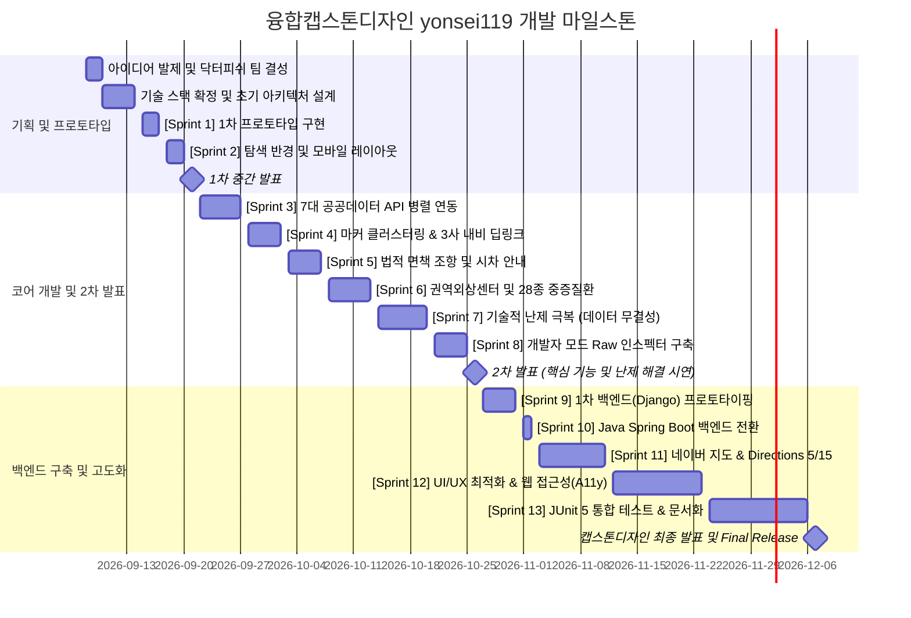

# 융합캡스톤디자인: 응급실 핑퐁 방지를 위한 위치 기반 실시간 응급의료 최적 추천 서비스

<div align="center">


  


**위치 기반 실시간 응급의료기관 최적 추천 · 다차원 의료 자원 인스펙션 · 네이버 자동차 경로(Directions 5/15) 관제 시스템**  
*저장소 명칭: `yonsei119` · 개발 팀명: `닥터피쉬 (Doctor Fish)`*

</div>

---

## 목차
1. [지도교수 및 팀 구성원](#1-지도교수-및-팀-구성원)
2. [프로젝트 폴더 구조](#2-프로젝트-폴더-구조)
3. [프로젝트 배경 및 목표](#3-프로젝트-배경-및-목표)
4. [프로젝트 벤치마킹 그리고 차별성](#4-프로젝트-벤치마킹-그리고-차별성)
5. [시스템 아키텍처 및 핵심 API](#5-시스템-아키텍처-및-핵심-api)
6. [프로젝트 타임라인 (2026.09.08 ~ 2026.12.07)](#6-프로젝트-타임라인-20260908--20261207)
7. [기술적 문제점 & 해결 방법](#7-기술적-문제점--해결-방법)
8. [주요 기능 및 UX/성능 최적화](#8-주요-기능-및-ux성능-최적화)

---

## 1. 지도교수 및 팀 구성원

### 지도교수

<div align="center">

| 교수명 | 소속 / 직함 |
| :---: | :---: |
| **최병관** | 연세대학교 미래캠퍼스 소프트웨어학부 교수 |

</div>

### 팀 구성원 및 역할 (팀명: 닥터피쉬)

<div align="center">

| 이름 | 학과 | 학번 | 담당 역할 |
| :---: | :---: | :---: | :--- |
| **김관호 (팀장)** | 소프트웨어학과 | 2021245078 | 프론트엔드 & 반응형 인터페이스 구현<br>레이아웃 최적화<br>바텀시트 제스처 UX & 웹 (WCAG 2.1) 설계 |
| **이재원** | 소프트웨어학과 | 2023245138 | OpenAPI 백엔드 메모리 캐시<br>네이버 지도(v3) 구현<br>내비게이션(네이버/카카오/티맵) 라우터 구현 |
| **장안나** | 컴퓨터정보통신공학부 | 2020253074 | XML 전수 분석 & 매핑 테이블 수립<br>상급종합병원(47개소) 분류기 및 중증질환-공지 교차 검증<br>데이터 무결성 검증 |

</div>

---

## 2. 프로젝트 폴더 구조

하나의 저장소(`yonsei119`) 아래에 클라이언트 PWA(`frontend/`)와 Spring Boot 4.2 서버(`backend/`), 자동화 테스트 및 컨테이너 배포 설정을 모듈 단위로 분리해 구성했습니다.

<div align="center">

| 영역 | 기준 경로 | 기술 구성 | 핵심 책임 |
| :---: | :--- | :--- | :--- |
| **클라이언트 웹 · PWA** | `frontend/` | HTML5 · 8 CSS · 11 ES Modules · Service Worker | 네이버 지도 v3 관제 UI, 병상·질환 인스펙션, 대학병원 배경 로고 워터마크, 오프라인 앱 쉘 폴백 |
| **백엔드 API · 수집 엔진** | `backend/src/main/` | Java 27.0.1.1 · Spring Boot 4.2.0 · Actuator | NEMC 7대 OpenAPI 병렬 수집, 60초 실시간 캐시·사전 직렬화 ETag, Directions/Geocoding 프록시, 보안 헤더·레이트 리미트 |
| **자동화 검증 스위트** | `backend/src/test/` | JUnit 5 · MockMvc · Playwright Chromium | 백엔드 API·캐시·보안 회귀 테스트 및 실브라우저 E2E 테스트 |
| **빌드 · 컨테이너 · 배포** | 루트 설정 파일 | Gradle 9.9.2 · Foojay JDK 27 · Docker | 단일 JAR(`yonsei119.jar`) 패키징, 경량 멀티스테이지 JRE 이미지 빌드, Render 자동 배포 |

</div>

<details open>
<summary><strong>프론트엔드 모듈 명세 (<code>frontend/</code>) — 진입 문서 · 8종 CSS · 11종 ES 모듈</strong></summary>

| 구분 | 파일명 | 주요 역할 |
| :---: | :--- | :--- |
| **문서 / PWA** | `index.html`, `manifest.webmanifest`, `sw.js` | 지도·필터·검색 패널(기본 반경 50km)·상세 시트 HTML 구조, PWA 매니페스트, Render 콜드스타트 보존 및 오프라인 서비스 워커 |
| **시각 자산** | `Assets/` · `Assets/badges/` | 앱 아이콘·다이어그램·발표 화면 15종 및 GitHub README 로컬 SVG 배지 8종 |
| **스타일시트 (`css/`)** | `style.css`, `panels-toolbar.css`, `map-overlays.css`, `sheet-egen.css` | 디자인 토큰, 필터 바·48×48 툴바, 반경 원·클러스터 배지, E-Gen 바텀시트 스타일 |
| **스타일시트 (`css/`)** | `directions-eta.css`, `dialogs-toast.css`, `dark-theme.css`, `responsive.css` | 주행 경로 배너·ETA 카드·소통 범례, 모달·토스트, 다크 관제 테마, 모바일 반응형 뷰포트 분기 |
| **초기화 · 상태 (`js/`)** | `theme-init.js`, `constants.js`, `state.js`, `utils.js`, `app.js` | 페인트 전 다크모드 초기화, NEMC 필드 사전, 전역 상태 store, 결측/초과수용/공지 판별, 앱 부트스트랩 |
| **지도 · 탐색 (`js/`)** | `map-engine.js`, `markers-cluster.js`, `search-controls.js` | 네이버 지도 v3 엔진·현위치 탐색, 종별 클러스터 마커·반경 원, 키워드·주소 검색 및 60초 자동 동기화 제어 |
| **상세 · 경로 (`js/`)** | `hospital-sheet.js`, `directions-eta.js`, `user-features.js` | 병원 상세 시트·대학병원 정적 배경 로고·개발자 모드 원시 인스펙터, Directions 5/15 경로선(교통 색상 1:1 일치·도서 페리 차단)·ETA 순위 |

</details>

<details open>
<summary><strong>백엔드 패키지 명세 (<code>backend/src/main/</code>) — Java 27.0.1.1 · Spring Boot 4.2.0</strong></summary>

| 패키지 | 클래스 / 리소스 | 주요 역할 |
| :---: | :--- | :--- |
| **`com.yonsei119`** | `Yonsei119Application` | `.env` 환경변수 자동 로드, 스케줄링 활성화 및 애플리케이션 부트스트랩 |
| **`...config`** | `Yonsei119Properties`, `WebConfig`, `SecurityHeadersFilter`, `ApiRateLimitFilter` | API 키·CORS·레이트 리미트 바인딩, 정적 리소스(Weak ETag), CSP 보안 헤더, IP 토큰 버킷 제한(429) |
| **`...controller`** | `EmergencyApiController` | `/api/config`, `/api/hospitals` (`ETag`/`304`), `/api/directions*`, `/api/geocode*`, `/api/health`(콜드스타트 워밍업 연동) 공개 REST API |
| **`...service`** | `NmcOpenApiClient`, `EmergencyDataService`, `HospitalClassifier`, `HospitalRecommendationScorer` | 7대 NEMC OpenAPI 병렬 XML 파싱, 60초 실시간 스냅샷 갱신·사전 직렬화·Micrometer 지표, 47개 상급종합 분류 및 추천 점수 |
| **`...service`** | `NaverDirectionsService`, `NaverGeocodingService`, `RouteCongestionAnalyzer` | 네이버 Directions 5/15 길찾기(해상 페리 감지 차단)·ETA 순위, 3단계 하이브리드 지오코딩·역지오코딩, 공식 구간 혼잡도 매핑 |
| **`...dto` / `util`** | DTO 레코드 8종 · `BoundedTtlCache`, `GeoUtils` | API 응답 불변 레코드 스키마, 용량 상한 TTL 인메모리 캐시, Haversine 구면 거리 연산 |
| **`resources/`** | `application.yml` | 가상 스레드(Virtual Threads), HTTP/2, Actuator 지표, 캐시·레이트 리미트 기본 구성 |

</details>

<details>
<summary><strong>테스트 · 빌드 · 클라우드 배포 명세 (<code>backend/src/test/</code> · 루트)</strong></summary>

| 영역 | 경로 / 파일 | 주요 역할 |
| :---: | :--- | :--- |
| **자동화 테스트** | `Yonsei119BackendTests`, `Yonsei119PlaywrightE2ETests` | JUnit 5 기반 백엔드 통합 검증 + Chromium 실브라우저 E2E 테스트 |
| **Gradle 멀티프로젝트** | `build.gradle`, `settings.gradle`, `backend/build.gradle` | Gradle 9.9.2 + Foojay JDK 27 툴체인, 프론트 정적 복사(`copyFrontendToStatic`), `checkAll`·`bootJar` 태스크 |
| **배포 · 환경 설정** | `Dockerfile`, `render.yaml`, `.env.example` | Java 27 경량 멀티스테이지 JRE 도커 빌드, Render 배포 정의, API 키 템플릿 |

</details>

---

## 3. 프로젝트 배경 및 목표

### 1. 응급실 핑퐁(재이송) 문제의 심각성 대두
* 야간 / 공휴일 등 의료 취약 시간대에 응급 환자가 발생했을 때, 병원의 수용 거부나 전문의 부재로 인해 구급차가 여러 병원을 전전하다 골든타임을 놓치는 '**응급실 핑퐁(재이송)**' 현상이 사회적 재난으로 대두되고 있습니다.
* 환자 보호자는 다급한 상황에서 어느 병원에 가야 즉시 처치를 받을 수 있는지 알지 못해 단순 포털 검색이나 119 문의에만 의존하게 됩니다.

### 2. 핵심 목표: "단순 거리순이 아닌 실시간 수용이 가능한지? 그리고 '실도로' 소요시간 기반의 최적의 경로 안내"
* **Java Spring Boot 백엔드 서버**를 이용해 국립중앙의료원(NEMC) OpenAPI와 **네이버 지도(NAVER Maps v3) 와 함께 지원하는 Directions 5 / 15 경로 API**를 이용하여 목적지까지 경로를 시각적으로 보여줍니다.

<div align="center">


</div>

---

## 4. 프로젝트 벤치마킹 그리고 차별성

* 이미 보건복지부 산하 국립중앙의료원에선 일반인들이 편리하게 사용할 수 있도록 응급의료포털(E-Gen)을 이미 서비스하고 있습니다.
* 그러나, 본 포털 사이트의 단점은 각 병원들의 위치를 정확히 알아내기가 어렵고 제공하는 서비스도 빈약하다는 것을 알 수 있습니다.
* 우린 이 단점들을 보완하고자 '네이버 지도 API'를 연동하였고 검색반경을 추가하여 보다 쉽게 알아볼 수 있는 서비스 구축을 우선으로 잡았습니다.

<div align="center">

[](https://mediboard.nemc.or.kr/)

**[중앙응급의료센터 응급의료포털 대시보드 (내 손안의 응급실)](https://mediboard.nemc.or.kr/)**  
전국 응급실 실시간 가용 병상 현황 및 중증 응급환자 수용 가능 정보를 제공하는 공식 대시보드

</div>

<div align="center">

| 비교 항목 | 기존 공식 대시보드 (E-Gen) | 본 프로젝트 (`yonsei119`) |
| :---: | :---: | :--- |
| **데이터 응답 속도** | 페이지 전환 시마다 개별 조회로 로딩 지연 | **Spring Boot 사전 로딩 및 60초 자동 캐싱으로 즉시(0.05초 내) 응답** |
| **지도 시각화** | 단순 리스트 및 텍스트 위주, 위치 파악 지연 | **네이버 지도(v3) 다크/일반 관제 뷰, 클러스터링 및 반경 원 표출** |
| **경로 및 소요시간** | 단순 직선거리 표기 또는 길찾기 연계 미흡 | **네이버 Directions 5/15 주행 경로선(교통 레이어 색상 일치), 예상 소요시간(분) 및 3사 내비 연동** |
| **검색 반경** | 행정구역(시·도/구·군) 단위 정적 조회 | **내 위치 기준 기본 50km (5km / 10km / 20km / 50km / 100km / 전국) 동적 탐색** |
| **데이터 무결성** | 결측치 및 기준 차이에 대한 설명 부재 | **결측치(`-`) vs `0`석(만실) vs 음수(`초과수용`) 분리, '개발자 모드' 공개** |
| **교차 검증** | 공지사항과 질환 수용 여부가 분리 표기됨 | **실시간 긴급 공지 본문을 정밀 파싱하여 실제 차단된 질환을 `[불가능]`으로 자동 전환** |

</div>

---

## 5. 시스템 아키텍처 및 핵심 API

### 1. 백엔드와 프론트엔드 통합

<div align="center">


</div>

### 2. REST API (`EmergencyApiController` / Controller 패키지로 구축)

<div align="center">

| HTTP 경로 | 담당 클래스 | 주요 기능 |
| :---: | :---: | :--- |
| `GET /api/config` | `EmergencyApiController` | 네이버 지도 클라이언트 ID, 다크모드 스타일 ID 및 기본 출발 좌표 반환 |
| `GET /api/hospitals` | `EmergencyDataService` | 전국 530여 개 기관 통합 데이터 반환 (`?compact=true`, `?refresh=true`, 사전 직렬화 + Weak `ETag` / `304 Not Modified`) |
| `GET /api/hospitals/{hpid}` | `EmergencyApiController` | 단건 병원 전체 원본 필드(개발자 모드 온디맨드 보강) 반환 |
| `GET /api/directions` | `NaverDirectionsService` | 출발지~병원 간 네이버 Directions 5/15 주행 경로선, 예상 소요시간, 요금 반환 *(해상 여객선 구간 감지 차단 및 IP Rate Limit 적용)* |
| `GET /api/directions/rank` | `NaverDirectionsService` | 주변 응급실 수용최적/최단시간 ETA 순위 산정 (기본 반경 50km) *(IP Rate Limit 적용)* |
| `GET /api/geocode` · `/reverse-geocode` | `NaverGeocodingService` | 3단계 하이브리드 주소 검색 및 출발 좌표 역지오코딩 *(IP Rate Limit 적용)* |
| `GET /api/health` · `/actuator/*` | `EmergencyApiController` · Actuator | 초기 캐시 워밍업(`503 WARMING_UP` → `200 UP`) 및 `/actuator/metrics` 커스텀 지표 노출 |

</div>

### 3. OpenAPI 파이프라인 (`NmcOpenApiClient` / service 패키지로 구축)

<div align="center">

| 오퍼레이션 명 | 서비스 기능 | 수집 및 활용 목적 |
| :---: | :---: | :--- |
| `getEgytListInfoInqire` | **응급의료기관 목록정보** | 전국 응급의료기관 마스터 데이터, 고유코드(`HPID`) 및 WGS84 좌표 확보 |
| `getEgytBassInfoInqire` | **응급의료기관 기본정보** | 응급실 대표전화, 인허가 병상 규모 및 진료과목 데이터 |
| `getEmrrmRltmUsefulSckbdInfoInqire` | **실시간 가용병상정보** | 일반/소아/격리/중환자실/입원실 가용 병상(`hvec` 등) 및 11종 장비 현황 |
| `getEmrrmSrsillDissMsgInqire` | **응급실/중증질환 메시지** | 실시간 진료 제한, 장비 점검, 전문의 부재 등 현장 긴급 공지 수신 |
| `getSrsillDissAceptncPosblInfoInqire` | **중증질환자 수용가능정보** | 뇌출혈, 심근경색, 대동맥, 투석 등 28종 중증질환별 처치 가능 여부 |
| `getStrmListInfoInqire` | **권역외상센터 목록정보** | 전국 권역외상센터 지정 기관 식별 및 마스터 정보 확보 |
| `getStrmBassInfoInqire` | **권역외상센터 기본정보** | 권역외상센터 상세 운영 정보 및 외상전용 병상/수술실 데이터 연동 |

</div>

---

## 6. 프로젝트 타임라인 (2026.09.08 ~ 2026.12.07)



### 1. 2026.09.08 — 최초 기획 및 팀 결성
* **아이디어 컨셉 구축**
  * 김관호: 위치 기반 공공데이터 연계 야간/공휴일 응급실 실시간 가용 병상 안내 서비스 제안
  * 이재원: 흉부 X-Ray 데이터셋 기반 폐렴 및 호흡기 질환 감지 AI 모델 제안
  * 장안나: 웹캠 모션 트래킹 기반 체형 불균형(척추·경추 각도) 진단 서비스 제안
* **최종 주제 확정**: '위치 기반 응급실 최적 추천 서비스' 선정 (팀명: '**닥터피쉬**'로 결정)

### 2. 2026.09.10 — 초기 설계 / 역할 분담 실시
* OS 종속성 없이 모바일과 데스크톱 브라우저에서 즉시 접근할 수 있는 반응형 웹 애플리케이션 아키텍처 채택
* 김관호(UI/UX 및 코어 프론트엔드), 이재원(API 인프라 및 지도·경로 연동), 장안나(공공데이터 스키마 분석 및 무결성 검증 모델) 역할 확정

### 3. 2026.09.15 — 첫 프로토타입 구현
* HTML5 Geolocation API 기반 사용자 좌표 수신 및 웹 지도 캔버스 연동
* 병원 종별(상급종합/권역응급/의료원/일반) 필터링 체계 및 사용자 중심 동적 탐색 반경(Circle Overlay) 도출

### 4. 2026.09.18 — 탐색 반경과 모바일 반응형 웹 설계
* 반경 설정 필터(5km, 10km, 20km, 50km, 100km, 전국 · 기본 50km) 및 Haversine 거리 연산 구현
* PC 데스크톱 및 모바일 스마트폰 뷰포트 분기 처리

### 5. 2026.09.21 — 1차 중간 발표
* **연세대학교 미래캠퍼스 융합캡스톤디자인 1차 중간 평가 발표**
* 응급실 핑퐁(재이송) 문제 해결을 위한 기획 배경 및 1차 프로토타입 데모 시연
* 심사위원 피드백 수렴: 대용량 공공데이터 조회 지연 시 브라우저 멈춤 방지 및 중증질환별 처치 가능 여부 세분화 필요성 확인

### 6. 2026.09.22 — 공공데이터 API 구축
* 타임아웃 및 비동기 병렬 수집 구조를 적용하여 개별 API 응답 지연이 전체 장애로 번지지 않도록 격리
* 수신된 XML 데이터들을 병원 고유 식별자(`HPID`)를 키로 교차 병합 및 정규화

### 7. 2026.09.28 — 국내 3대 내비게이션(네이버지도, T맵, 카카오맵) 링크 연동
* **네이버지도, 카카오맵, T-map** 3대 모바일 내비게이션 앱 자동 실행 폴백 개발

### 8. 2026.10.03 — 법적 면책 조항 팝업 창 구현 / 프로젝트 저장소명 교체
* GitHub 저장소 명칭 변경 (`Gpt-proj` → `yonsei119`)
* 공공데이터 연계 시차에 따른 현장 혼선 방지를 위한 이용 안내 및 면책 조항 팝업 구현

### 9. 2026.10.08 — 권역외상센터와 28종의 중증응급질환 구현 (API 지원)
* 권역외상센터(Regional Trauma Center) 마스터 데이터 연동 및 전용 식별 배지 추가
* 28종 중증응급질환(`mkioskty1` ~ `mkioskty28`) 수용 가능 보드 및 11종 핵심 응급의료 장비 현황판 연동

### 10. 2026.10.14 — 3대 기술적 문제점 인식 -> 대응
* 결측치(`null`, 빈 태그)와 `0`석(만실)을 엄격히 분리하여 결측치는 `-` 대시로 표기로 변경합니다.
* 음수 병상 값(`-2` 등)이 '**초과수용(Overcapacity)**'을 의미함을 규명합니다.
* 활성 공지 본문에서 실제 '차단/불가/제한' 키워드 감지 시 해당 질환을 `[불가능]`으로 자동 전환하도록 교차 검증을 구현했습니다.

### 11. 2026.10.21 — 개발자 모드 추가
* API 수신 원본을 무가공 상태로 대조할 수 있도록 따로이 안전장치 마련 덕분에 실제 응답을 1:1로 직접 검증할 수 있음.

### 12. 2026.10.26 — 2차 발표
* **융합캡스톤디자인 2차 중간 점검 발표**
* **2차 발표 피드백 반영 및 백엔드 도입 결정**:
  * 브라우저 직접 호출 시 발생하는 **API 인증키 노출 문제**와 접속자별 **초기 로딩 지연**을 해결하기 위해 전용 백엔드 서버 도입 결정 (프레임워크 JAVA Spring 결정)
  * 단순 직선거리 외에 **실제 자동차 주행 경로 및 예상 소요 시간(ETA)** 산출 기능 도입 결정

### 13. 2026.10.27 — 첫 백엔드 구축 -> Python Django
* 클라이언트 단일 구조(Vanilla Javascript) -> 백엔드 프레임워크로 전환 설계
* 전환해야 할 이유는 보안 그리고 코드의 일관성을 위해 전환을 결심
* Python Django 프레임워크 기반 첫 백엔드 구축하여 API 병렬 수집, 데이터 병합, 메모리 캐싱 구조 등 여러건 검증이 가능

### 14. 2026.11.01 — Java Spring Boot 백엔드 전환 및 서버 자동 캐싱 구축
* 멀티스레드 병렬 처리 안정성과 정적 타입 안전성을 위해 백엔드를 **Java 17 + Spring Boot 4.1 (Gradle)** 환경으로 전환할 것으로 재결정

### 15. 2026.11.03 — 네이버 지도(v3) 전환 및 Directions 5 / 15 실시간 경로 연동
* 지도 엔진을 카카오Maps -> **네이버 Maps API v3**로 전환하고 다크 모드 스타일 추가
* 백엔드 `NaverDirectionsService`를 통해 **네이버 Directions 5 및 Directions 15 API**를 연동하여 경로 구현

### 16. 2026.11.12 — UI/UX 최적화 및 웹 접근성(A11y WCAG 2.1) 검증
* 초기 렌더링 속도 향상을 위해 `'일반·기타'` 필터 기본 체크 해제 적용 및 우측 하단 새로고침 버튼 옆 `'갱신 시간'` 통합 배치
* 전광판(Marquee) 레이아웃 스래싱 차단, 모바일 바텀시트 GPU 가속(`translate3d`) 및 포커스 트랩 등 웹 접근성 완비

### 17. 2026.11.24 — JUnit 5 통합 테스트, 크로스 브라우징 검증 및 문서화
* `Yonsei119BackendTests` 기반 백엔드 핵심 도메인 자동화 단위 테스트 완비 및 전 모듈 코드 문서화 완료
* **보안 패치 및 최신 스택 고도화**: CVE-2026-114938(Java4Shell) 대응 **Java 27.0.1.1**(`eclipse-temurin:27.0.1.1_4`), **Spring Boot 4.2.0**(가상 스레드·HTTP/2·Graceful Shutdown), **Gradle 9.9.2** 업그레이드 및 `yonsei119.jar` 단일 프로젝트명 통일 완료

### 18. 2026.12.07 — 융합캡스톤디자인 최종 성과 발표 및 프로젝트 완성
* **융합캡스톤디자인 최종 성과 발표회 및 작품 전시**
* Java Spring Boot 백엔드 + 네이버 지도·Directions 5/15 기반 실시간 응급의료 최적 추천 서비스(`yonsei119`) 최종본 라이브 시연

---

## 7. 기술적 문제점 & 해결 방법

<div align="center">

| 구분 | \[난제 1\] API 호출 지연 및 시차 | \[난제 2\] AI 도구 의존의 맹점 | \[난제 3\] 결측치 및 집계 불일치 |
| :---: | :---: | :---: | :---: |
| **핵심 이슈** | 브라우저 직접 호출 시 로딩 지연<br>E-Gen 중앙망 vs 공공 API 시차 | 인증키 이중 인코딩 오류<br>불명확한 필드명(`hvs` 등) 오해석 가능성 | 결측치(`null`)를 `0`석(만실)으로 오인<br>음수 병상값 및 공지 불일치 |
| **원인 분석** | 개별 요청의 병목 현상으로 의심됨 | 실제 생성 코드와<br>기준 병상수를 질환 번호로 오분류하는 환각 발견 | XML 태그 누락 빈번<br>현장 공지와 질환 API 간 갱신 시차 |
| **자체 해결** | **Spring Boot 사전 로딩 & 60초 자동 캐싱 구현** | **개발자 모드**를 구현하여 원본값과 수신값이 서로 일치하는지 무결성 추가 | **결측치 `-` vs `0`석 엄격 분리 표기**<br>**음수 `'초과수용'` 파싱 및 교차검증** |

</div>

### 클라이언트 다중 API 호출 병목 및 공공데이터 동기화 시차
* **현상**: 기존 브라우저 직접 호출 구조에서는 접속 시마다 7개의 대용량 XML을 내려받아야 했고, 병원 현장 상황이 공공데이터포털로 미러링되기까지 구조적인 시차가 존재했습니다.
* **해결책**:
  1. **Spring Boot 백엔드 캐시 엔진(`EmergencyDataService`) 구축**: 서버 기동 즉시 백그라운드에서 530여 개 병원 데이터를 미리 수집(`warmUpCacheOnStartup`)하고 60초마다 자동 갱신(`@Scheduled`)하며, 프론트엔드도 열린 탭에서 60초 주기로 무음 동기화(`If-None-Match` ETag)하여 **0.05초 이내 즉시 응답**을 달성했습니다.
  2. **수신 시각 표출 및 직통 전화 연결**: 새로고침 버튼 우측에 수신 타임스탬프(`HH:MM`)를 명시하고, 원클릭 응급실 직통전화(`tel:`) 버튼과 면책 조항 팝업을 배치했습니다.

### AI 코드 생성 도구의 맹점과 명세서(V13) 전수 수동 검증
* **현상**: 공공데이터 인증키(`serviceKey`) 이중 인코딩 에러가 발생하거나, 직관성이 떨어지는 필드명(`hvec`, `hvs01`, `mkioskty1` 등)을 잘못 매핑하는 환각 코드가 발생했습니다.
* **해결책**:
  1. 백엔드 `NmcOpenApiClient.ensureUrlEncodedServiceKey()`에서 인증키 인코딩 여부를 자동 판별하여 이중 인코딩 오류를 차단했습니다.
  2. 공식 OpenAPI 활용가이드(V13)를 1:1로 전수 대조하여 **`HV_LABELS`**, **`HVS_LABELS`**, **`MKIOSKTY_METADATA`** 사전을 수동 구축하고, 원본 데이터를 확인하는 **'개발자 모드(Raw Inspector)'**를 구현했습니다.

### 결측값(Null) 처리 및 음수 초과수용·긴급공지 교차 검증
* **현상**: 비어있는 결측값을 단순 `0`으로 치환하면 **"정보 미제공"이 "만실(0석)"로 왜곡**되며, 음수 병상 값(`-3` 등)을 오류로 버리면 현장 과밀 정보를 잃게 됩니다.
* **해결책**:
  1. **백엔드 원본 문자열 보존**: `NmcOpenApiClient`에서 XML 텍스트를 숫자로 강제 형변환하지 않고 빈 문자열(`""`)과 음수(`"-3"`)를 그대로 보존합니다.
  2. **결측치와 초과수용 분리**: 결측값은 `-` 대시로, 음수 값은 **'기준 정원 초과 수용'**으로 판독하여 `초과수용 N/기준` 빨간색 배지로 표출합니다.
  3. **긴급 공지 교차 검증**: 질환 API가 `'가능(Y)'`이어도 활성 공지 본문에 실제 `'불가/차단/부재/제한'` 키워드가 있으면 `[불가능]`으로 자동 오버라이드합니다.

```javascript
// 결측치(공란)와 음수 초과수용을 엄격히 구분하는 핵심 로직 (frontend/js/hospital-sheet.js)
if (isBlankOrNull(rawVal)) {
    return { className: 'egen-badge-dash', text: '-' }; // 미정보(결측치)
}
if (current < 0) {
    const overflow = Math.abs(current);
    return { className: 'egen-badge-pill-red egen-badge-overflow', text: `초과수용 ${overflow}` }; // 정원 초과 수용 중
}
```

---

## 8. 주요 기능 및 UX/성능 최적화

### 1. 네이버 Directions 5 / Directions 15 기반 실시간 자동차 경로 및 소요시간(ETA)
* 병원 상세 시트에서 **Directions 5 (일반 빠른탐색)**와 **Directions 15 (다중경유·광역)** 엔진 및 주행 옵션(`실시간 빠른길`, `실시간 최적`, `실시간 편한길`, `무료 우선`)을 선택할 수 있습니다.
* 네이버 실시간 교통정보 레이어와 1:1로 통일된 소통 색상(원활 `#27c441`, 서행 `#ff8d00`, 정체 `#ff3b30`, 미계측 기본선 `#3b82f6`)으로 경로선을 렌더링하며, 울릉도 등 해상 여객선(페리) 구간이 포함된 목적지는 실제 네이버 지도 서비스와 동일하게 자동차 경로 안내를 차단합니다.

### 2. 백엔드 사전 로딩(Pre-warming) 캐싱 및 Render 무료 플랜 콜드스타트 최적화
* 초기 7종 공공데이터 적재 완료 전까지 `/api/health`가 `503(WARMING_UP)`을 반환하고 서비스 워커(`sw.js`)가 문서 진입 요청을 타임아웃 없이 통과시켜, Render Free 플랜 휴면 복귀 시 기본 로딩 화면이 끝난 직후 모든 병원 카드가 즉시 표시됩니다.
* 초기 지도 렌더링 성능을 위해 최초 접속 시 `'일반·기타'` 필터는 기본 체크 해제 상태로 시작하며, 권역응급의료센터·상급종합병원·의료원을 우선 표출합니다.

### 3. 전광판 텍스트 애니메이션 및 레이아웃 스래싱 방지
* 긴 진료과목명 및 파라미터 텍스트가 박스를 넘어갈 경우 부드러운 Marquee 스크롤 애니메이션이 작동합니다.
* `requestAnimationFrame` 내에서 **DOM 측정(Read)과 스타일 주입(Write)**을 분리하여 대량 카드 렌더링 시 브라우저 강제 리플로우를 차단했습니다.

### 4. GPU 하드웨어 가속 기반 모바일 바텀시트 & 웹 접근성(A11y)
* 모바일 환경에서 상단 핸들을 스와이프하면 바텀시트가 자연스럽게 닫히며, `translate3d(0, delta, 0)`와 Safe Area Inset 패딩을 적용했습니다.
* 모달 및 바텀시트 활성화 시 백그라운드 요소에 `inert` 속성을 부여하고, `Escape` 키 닫기 및 시트 내부 `Tab` 키 포커스 트랩(Focus Trap)을 완비했습니다.

### 5. `/api/hospitals` 사전 직렬화 ETag · 관측(Actuator)
* **스냅샷 사전 직렬화 & `ETag` (`304 Not Modified`)**: `EmergencyDataService`가 스냅샷 갱신 시 전체·경량 JSON 바이트와 SHA-256 기반 Weak `ETag`를 1회 사전 생성해 다중 클라이언트 재요청 시 CPU·대역폭 소모를 최소화합니다.
* **Spring Boot Actuator & Micrometer**: `/actuator/health`, `/actuator/metrics`에서 캐시 병원 수(`yonsei119.hospitals.cached.count`), 스냅샷 적중·`304` 비율, NEMC OpenAPI 호출 결과 및 레이트 리미트 차단 건수를 관측할 수 있습니다.

### 6. 엄격한 CSP 보안 헤더 · IP 레이트 리미터 · Playwright 실브라우저 E2E
* **Content Security Policy (`SecurityHeadersFilter`)**: 네이버 지도 SDK·WebGL 스타일·한글 웹폰트·워커(`blob:`) 출처만 명시적으로 허용하고 HTML 인라인 이벤트 핸들러를 제거해 XSS 방어를 강화했습니다.
* **IP 토큰 버킷 레이트 리미터 (`ApiRateLimitFilter`)**: 네이버 유료 API를 대리 호출하는 `/api/directions*`, `/api/geocode*` 엔드포인트에 기본 분당 60회 제한(`X-RateLimit-*`, `429 Too Many Requests` + `Retry-After`)을 적용합니다.
* **Playwright 실브라우저 E2E (`Yonsei119PlaywrightE2ETests`)**: 실제 Chromium에서 Render `503` 지연 복구, 초기 다크모드, CSP 무위반, 기본 탐색 반경 `50 km`, 대학병원 배경 로고·ETA 순위 흐름을 자동 검증합니다.

### 7. 전국 대학교병원 정적 배경 로고 워터마크
* **소속 대학교 엠블럼 배경 (`#sheet-univ-watermark`)**: 전국 대학교병원 및 상급종합병원(의료원 제외) 상세 시트를 열면 소속 대학교 로고가 가장 뒤 배경에 다크·라이트 테마 맞춤 투명도로 정적 배치되어 스크롤 시에도 흔들림 없이 유지됩니다.

### 8. 로컬 실행 환경 설정 (`.env` / `.env.backup`)
1. 프로젝트 루트의 `.env`(백업본 `.env.backup`) 파일에 `NEMC_API_SERVICE_KEY`와 `NAVER_MAP_CLIENT_SECRET`을 입력합니다. (`.gitignore`에 등록되어 Git에 커밋되지 않습니다.)
2. IntelliJ `Yonsei119Application (Spring Boot)` 실행 구성 또는 터미널 `.\gradlew.bat bootRun`으로 실행한 뒤 `http://localhost:8080`에 접속합니다.
