# 융합캡스톤디자인: 응급실 핑퐁 방지를 위한 위치 기반 실시간 응급의료 최적 추천 서비스

<div align="center">


**위치 기반 실시간 응급 의료기관 최적 추천 및 다차원 의료 자원 인스펙션 대시보드**  
*저장소 명칭: `yonsei119` · 개발 팀명: `닥터피쉬 (Doctor Fish)`*

</div>

---

## 📌 목차
1. [지도교수 및 팀 구성원](#-지도교수-및-팀-구성원)
2. [프로젝트 배경 및 목표](#-프로젝트-배경-및-목표)
3. [선행 벤치마킹 및 차별성 분석](#-선행-벤치마킹-및-차별성-분석)
4. [시스템 아키텍처 및 핵심 API](#-시스템-아키텍처-및-핵심-api)
5. [프로젝트 타임라인 (2026.09.08 ~ 2026.12.07)](#-프로젝트-타임라인-20260908--20261207)
6. [3대 기술적 난제 및 자체 해결 전략](#-3대-기술적-난제-및-자체-해결-전략)
7. [주요 기능 및 UX/성능 최적화](#-주요-기능-및-ux성능-최적화)
8. [화면 갤러리](#-화면-갤러리)
9. [실행 및 로컬 테스트 방법](#-실행-및-로컬-테스트-방법)

---

## 👨‍🏫 지도교수 및 팀 구성원

### 지도교수
| 교수명 | 소속 / 직함 |
| :---: | :---: |
| **최병관** | 연세대학교 미래캠퍼스 소프트웨어학부 교수 |

### 팀 구성원 및 역할 (팀명: 닥터피쉬)
| 이름 | 학과 | 학번 | 담당 역할 |
| :---: | :---: | :---: | :--- |
| **김관호 (팀장)** | 소프트웨어학과 | 2021245078 | • 프론트엔드 코어 아키텍처 및 반응형 인터페이스 구현<br>• 레이아웃 스래싱 차단 및 GPU 하드웨어 가속 최적화<br>• 바텀시트 제스처 UX 및 WCAG 2.1 접근성 설계 |
| **이재원** | 소프트웨어학과 | 2023245138 | • 국립중앙의료원 7대 비동기 병렬 API 수집 파이프라인 구축<br>• 카카오맵 지도 클러스터링 및 GPS 지리 연산(Haversine) 구현<br>• 3대 내비게이션(카카오/네이버/티맵) 딥링크 폴백 라우터 개발 |
| **장안나** | 컴퓨터정보통신공학부 | 2020253074 | • 공공데이터 XML 스키마 전수 분석 및 필드 매핑 테이블 수립<br>• 27종 중증질환-실시간 긴급 공지 교차 검증 알고리즘 설계<br>• 결측치(-) 및 음수 초과수용 데이터 무결성 정합성 검증 |

---

## 🎯 프로젝트 배경 및 목표

### 1. 응급실 핑퐁(재이송) 문제의 심각성
* 야간 및 공휴일 등 의료 취약 시간대에 응급 환자가 발생했을 때, 병원의 수용 거부나 전문의 부재로 인해 구급차가 여러 병원을 전전하다 골든타임을 놓치는 **'응급실 핑퐁(재이송)'** 현상이 사회적 재난으로 대두되고 있습니다.
* 환자 보호자는 다급한 상황에서 어느 병원에 가야 즉시 처치를 받을 수 있는지 알지 못해 단순 포털 검색이나 119 문의에만 의존하게 됩니다.

### 2. 핵심 목표: "단순 거리순이 아닌 실시간 수용 가능성 기반 최적 추천"
* 본 과제는 국립중앙의료원(NEMC) 공공데이터포털 실시간 OpenAPI와 웹 지도 API를 연동하여, **[실시간 이동시간 + 현재 잔여 병상 수 + 증상별 처치 가능 여부 + 현장 긴급 공지]**를 종합 연산하는 **위치 기반 실시간 응급의료 최적 추천 서비스**를 구축합니다.
* AI 생성 코드의 오류를 극복하고 원시 데이터의 무결성을 확보하여, 응급환자와 의료진 모두에게 가장 신뢰할 수 있는 정보를 제공합니다.

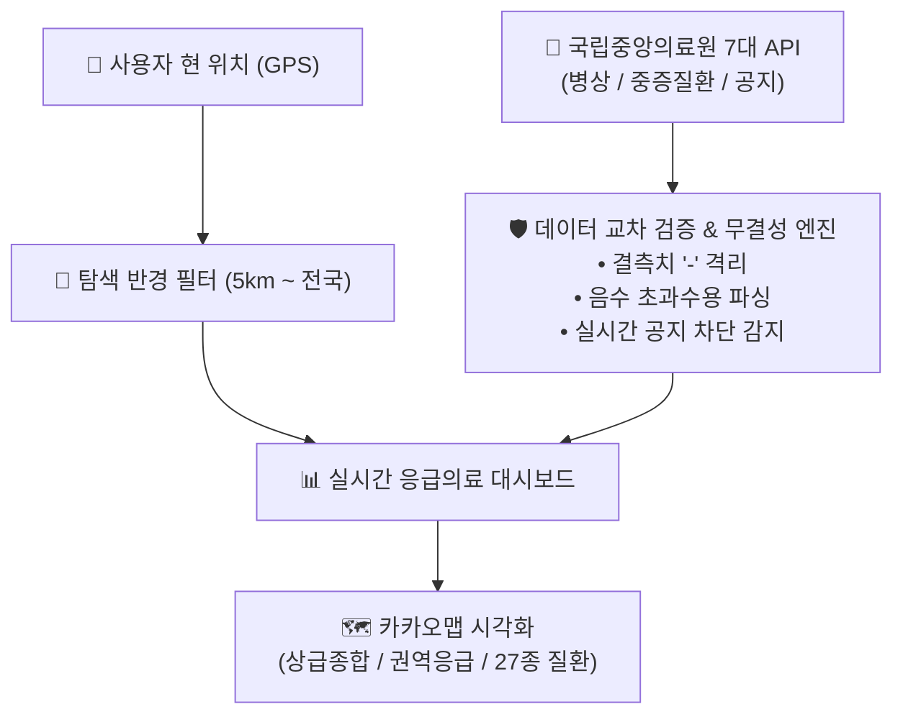

---

## 🔍 선행 벤치마킹 및 차별성 분석

<div align="center">
  <a href="https://mediboard.nemc.or.kr/" target="_blank">
    
  </a>
  <br>
  <strong><a href="https://mediboard.nemc.or.kr/" target="_blank">중앙응급의료센터 응급의료포털 대시보드 (내 손안의 응급실)</a></strong>
  <p>전국 응급실 실시간 가용 병상 현황 및 중증 응급환자 수용 가능 정보를 제공하는 국가 공식 대시보드</p>
</div>

| 비교 항목 | 기존 공식 대시보드 (E-Gen) | 본 프로젝트 (`yonsei119`) |
| :--- | :--- | :--- |
| **지도 시각화** | 단순 리스트 및 텍스트 위주, 위치 파악 지연 | **카카오맵 연동 실시간 클러스터링 및 반경 가이드 원 표출** |
| **검색 반경** | 행정구역(시·도/구·군) 단위 정적 조회 | **내 위치 기준 5km/10km/20km/50km/100km/전국 동적 탐색** |
| **이동 연계** | 길찾기 연계 미흡 | **원클릭 카카오맵 / 네이버지도 / T-map 모바일 딥링크 자동 실행** |
| **데이터 무결성** | 결측치 및 기준 차이에 대한 설명 부재 | **결측치(-) vs 0석 엄격 분리 표기, '개발자 모드' 원본 투명 공개** |
| **교차 검증** | 공지사항과 질환 수용 여부가 분리 표기됨 | **실시간 긴급 공지를 파싱하여 차단된 질환을 [불가능]으로 자동 오버라이드** |

---

## 🏗 시스템 아키텍처 및 핵심 API

### 1. 인프라 구성도

<p align="center">
  
  &nbsp;&nbsp;&nbsp;&nbsp;
  
  <br>
  <sub>▲ 카카오 지도 SDK 연동 및 공공데이터포털 Open API 활용 인프라</sub>
</p>

### 2. 국립중앙의료원 7대 API 비동기 병렬 파이프라인
공공데이터포털 `국립중앙의료원_전국 응급의료기관 정보 조회 서비스` 전체 오퍼레이션 중 서비스 코어에 필요한 엔드포인트를 선별하여 비동기 병렬 수집 파이프라인을 구축했습니다.

| 오퍼레이션 명 | 서비스 기능 | 수집 및 활용 목적 |
| :--- | :--- | :--- |
| `getEgytListInfoInqire` | **응급의료기관 목록정보** | 전국 응급의료기관 기본 마스터 데이터 및 고유 식별자(HPID) 확보 |
| `getEgytLcinfoInqire` | **응급의료기관 위치정보** | WGS84 위도/경도 좌표 수신 및 지도 매핑 |
| `getEgytBassInfoInqire` | **응급의료기관 기본정보** | 응급실 대표전화, 인허가 병상 규모 및 진료과목 데이터 |
| `getEmrrmRltmUsefulSckbdInfoInqire` | **실시간 가용병상정보** | 일반/소아/음압격리/중환자실 가용 병상(`hvec` 등) 및 10대 장비 보유 현황 |
| `getEmrrmSrsillDissMsgInqire` | **응급실/중증질환 메시지** | 실시간 진료 제한, 장비 고장, 전문의 부재 등 텍스트 공지 수신 |
| `getSrsillDissAceptncPosblInfoInqire` | **중증질환자 수용가능정보** | 뇌출혈, 심근경색, 대동맥 등 27종 중증응급질환별 수술/처치 가능 여부 |
| `getStrmListInfoInqire` 외 2종 | **권역외상센터 전용정보** | 권역외상센터 목록, 외상소생실 및 외상 전용 중환자실 데이터 연동 |

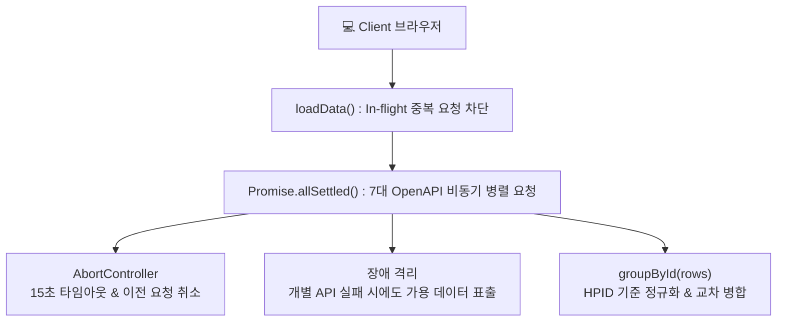

---

## 📅 프로젝트 타임라인 (2026.09.08 ~ 2026.12.07)

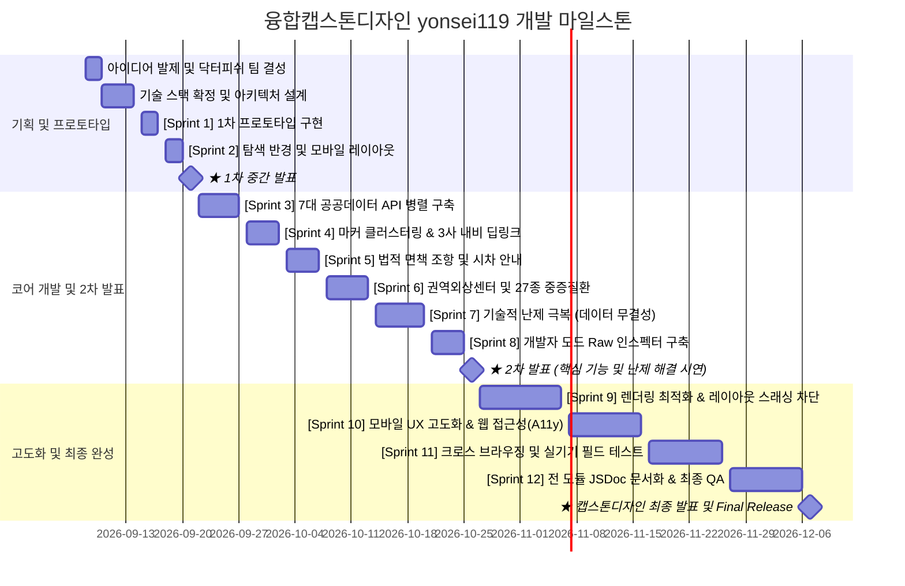

### 1. 2026.09.08 — 최초 기획 및 팀 결성
* **아이디어 브레인스토밍**
  * 김관호: 위치 기반 공공데이터 연계 야간/공휴일 응급실 실시간 가용 병상 안내 서비스 제안
  * 이재원: 흉부 X-Ray 데이터셋 기반 폐렴 및 호흡기 질환 감지 AI 모델 제안
  * 장안나: 웹캠 모션 트래킹 기반 체형 불균형(척추·경추 각도) 진단 서비스 제안
* **최종 주제 확정**: 사회적 시급성과 실시간 데이터 연계 가치가 높은 '위치 기반 응급실 최적 추천 서비스' 선정 (팀명: **닥터피쉬**)

### 2. 2026.09.10 — 플랫폼 아키텍처 및 역할 분담 확정
* 네이티브 앱의 OS 종속성 한계를 탈피하고 즉각적인 접근성을 보장하기 위해 **Vanilla Web Standards (HTML5/CSS3/ES6+)** 채택
* IDE로 정적 분석 및 웹 표준 개발 효율이 높은 **JetBrains WebStorm** 환경 구축
* 김관호(UI/UX 및 코어 프론트엔드), 이재원(API 인프라 및 지도 SDK), 장안나(데이터 파이프라인 및 추천 모델) 역할 확정

### 3. 2026.09.15 — [Sprint 1] 1차 프로토타입 구현
* HTML5 Geolocation API 기반 사용자 좌표 수신 및 카카오 지도 캔버스 연동
* 최초 프로토타입 인터페이스 검증 및 개선점 도출:
  * 병원 종별(상급종합/일반/의료원) 세부 필터링 체계 필요
  * 사용자 중심의 동적 탐색 반경(Circle Overlay) 시각화 필요
  * GPS 오차 대응을 위한 '현 위치 재탐색' 수동 트리거 필요

### 4. 2026.09.18 — [Sprint 2] 동적 탐색 반경 및 모바일 반응형 뷰포트 설계
* 독립 반경 설정 팝오버(5km, 10km, 20km, 50km, 100km, 전국) 구현
* Haversine 구면 삼각법 공식을 적용한 거리 연산 및 지도 반경 원(Circle) 동적 피팅 구현
* PC 데스크톱 및 모바일 스마트폰 뷰포트 분기 처리

### 5. 2026.09.21 — [Milestone] 1차 중간 발표
* **연세대학교 미래캠퍼스 융합캡스톤디자인 1차 중간 평가 발표**
* 응급실 핑퐁(재이송) 문제 해결을 위한 공공데이터 연계 기획 배경 및 1차 프로토타입(Geolocation + 카카오맵 연동) 데모 시연
* 지도교수 및 심사위원 피드백 수렴:
  * 대용량 공공데이터 조회 지연 시 브라우저 멈춤 방지 방안 요구
  * 단순 병상 수 표출을 넘어 27종 중증질환별 처치 가능 여부 세분화 필요성 확인

### 6. 2026.09.22 — [Sprint 3] 7대 공공데이터 API 비동기 병렬 파이프라인 구축
* `AbortController` 타임아웃(15초) 및 `Promise.allSettled`를 적용하여 API 응답 지연이 전체 시스템 장애로 번지지 않도록 격리
* 수신된 XML 데이터들을 병원 고유 식별자(HPID)를 키로 교차 병합 및 정규화
* `In-flight Promise Deduplication`을 구현하여 중복 새로고침 요청 방지

### 7. 2026.09.28 — [Sprint 4] 마커 클러스터링 계층화 & 3대 내비게이션 딥링크 연동
* 겹치는 마커가 많은 도심 지역의 가독성을 확보하기 위해 거리 기반 클러스터링 카드 모달 구현
* 응급 환자 이송을 위해 **카카오맵, 네이버지도, T-map** 3대 모바일 내비게이션 앱 자동 실행 인텐트 및 웹 폴백(Fallback) 라우터 개발

### 8. 2026.10.03 — [Sprint 5] 법적 면책 조항 모달 구현 및 저장소 리네이밍
* GitHub 저장소 명칭 변경 (`Gpt-proj` → `yonsei119`)
* 공공데이터 연계 시차에 따른 현장 혼선 방지 및 서비스 법적 신뢰도 확보를 위한 이용 안내 및 면책 조항 팝업(`localStorage` 기억 기능 포함) 구현

### 9. 2026.10.08 — [Sprint 6] 권역외상센터 및 27종 중증응급질환 매트릭스 연동
* 권역외상센터(Regional Trauma Center) 마스터 데이터 연동 및 전용 식별 배지 추가
* 27종 중증응급질환(`mkioskty1` ~ `mkioskty28`) 수용 가능 정보 렌더링 카드 설계
* 10대 핵심 응급의료 장비(인공호흡기, ECMO, CRRT, CT, MRI 등) 가용 현황판 연동

### 10. 2026.10.14 — [Sprint 7] 3대 기술적 난제 극복 (결측치, 음수 초과수용, 공지 교차검증)
* 결측치(`null`, 빈 태그)와 0석을 엄격히 분리하여 결측치는 `[-]` 대시로 표기
* 공공데이터 특유의 음수 병상 값(`-2` 등)이 **'초과수용'**을 의미함을 규명하고 빨간색 배지로 정확히 파싱
* API 상으로는 '가능'이어도 활성 공지에서 '차단/불가' 키워드가 감지되면 해당 질환을 자동으로 `[불가능]`으로 오버라이드하는 교차 검증 엔진 개발

### 11. 2026.10.21 — [Sprint 8] 개발자 모드(Developer Mode Raw Inspector) 구축 및 2차 발표 준비
* API 수신 원본을 무가공 상태로 대조할 수 있는 인스펙터 구축 (`renderRawBeds`, `renderRawSevere`, `renderRawMessages`)
* AI 도구의 데이터 오해석을 방지하고 공식 명세서와 실제 응답을 1:1로 직접 검증할 수 있는 디버깅 체계 완성
* 2차 발표 시연 시나리오 및 기술 난제 극복 검증 데이터셋 준비

### 12. 2026.10.26 — [Milestone] 2차 발표
* **융합캡스톤디자인 2차 중간 점검 발표**
* 7대 OpenAPI 비동기 병렬 수집 파이프라인 및 장애 격리(Fault Tolerance) 라이브 시연
* AI 도구 환각 극복(수동 매핑 사전 구축) 및 결측치/초과수용 정합성 검증 엔진 동작 검증
* 2차 피드백 반영 및 향후 일정 수립: 대용량 렌더링 최적화, 웹 접근성 표준 준수, 실기기 필드 테스트 계획 발표

### 13. 2026.10.27 — [Sprint 9] 프론트엔드 성능 최적화 및 렌더링 스래싱 차단
* 전광판 텍스트(Marquee) 렌더링 시 읽기/쓰기 단계를 분리하여 **레이아웃 스래싱(Layout Thrashing)** 원천 차단
* 모바일 바텀시트 스와이프에 GPU 가속 `translate3d(0, delta, 0)` 적용
* `DocumentFragment` 일괄 삽입을 통한 검색창 타이핑 리플로우 최소화

### 14. 2026.11.07 — [Sprint 10] 사용자 경험(UX) 고도화 및 웹 접근성(A11y WCAG 2.1) 검증
* 모달 및 바텀시트 활성화 시 백그라운드 요소에 `inert` 속성을 부여하여 초점 분산 방지
* `Escape` 키를 통한 계층적 레이어 닫기 및 시트 내부 `Tab` 키 포커스 트랩(Focus Trap) 완비
* 최신 스마트폰 노치(Notch) 및 홈 바 보호를 위한 `viewport-fit=cover` 및 Safe Area Inset 패딩 적용

### 15. 2026.11.17 — [Sprint 11] 크로스 브라우징 및 실기기 필드 테스트 & 예외 처리 강화
* iOS Safari, Android Chrome, 삼성 인터넷 등 주요 모바일/데스크톱 브라우저 환경 전수 호환성 검증
* GPS 신호 수신 실패 및 위치 권한 거부 시 서울역 기본 좌표 폴백 및 단계별 안내 토스트 강화
* 공공데이터 API 서버 순단 및 네트워크 불안정 시 자동 재시도(Retry) 백오프 안내 모달 고도화

### 16. 2026.11.27 — [Sprint 12] 전 모듈 코드 문서화(JSDoc), 최종 품질 검증(QA) 및 배포 인프라 안정화
* `index.html`, `style.css`, `app.js` 전 코드에 걸쳐 19개 모듈 JSDoc 명세 및 아키텍처 주석 완비
* 브라우저 개발자 도구 콘솔 무경고/무에러 달성 및 성능 벤치마크 점검
* 캡스톤 최종 심사용 결과 보고서, 시연 영상 제작 및 GitHub Pages 배포 환경 최종 검증

### 17. 2026.12.07 — [Final Release] 융합캡스톤디자인 최종 성과 발표 및 프로젝트 최종 완성
* **융합캡스톤디자인 최종 성과 발표회 및 작품 전시**
* 위치 기반 실시간 응급의료 최적 추천 서비스 (`yonsei119`) 완성작 공개 및 라이브 시연
* 응급실 핑퐁 문제 해결을 위한 공공데이터 기반 실시간 의사결정 지원 플랫폼 최종 릴리즈

---

## ⚡ 3대 기술적 난제 및 자체 해결 전략

| 구분 | ⏱️ [난제 1] 데이터 동기화 시차 | 🤖 [난제 2] AI 도구 의존의 맹점 | 🛡️ [난제 3] 결측치 및 집계 불일치 |
| :---: | :--- | :--- | :--- |
| **핵심 이슈** | • E-Gen 중앙망 vs 공공 API 시차 (최대 30분)<br>• 배치 갱신 및 캐싱 구조적 지연 | • AI 환경 외부 통신 차단 (HTTP 403)<br>• 의미 불명확한 필드명(`hvs` 등) 오해석 | • 결측치(Null)를 단순 0(만실)으로 오인<br>• 음수 병상값 및 병상 모수 불일치 |
| **원인 분석** | • 망 분리 보안 정책 및 대용량 배치 처리<br>• API 서버의 스냅샷 폴링 구조 | • AI의 실제 응답 미검증 환각 코드 생성<br>• 기준 병상수를 질환 번호로 오분류 | • XML 태그 누락 빈번<br>• E-Gen과 공공데이터의 수집 기준 상이 |
| **자체 해결** | • **데이터 수신 타임스탬프(`KST`) 투명 공개**<br>• **원클릭 유선 확인(`tel:`) 직통 버튼 배치** | • **개발자 수동 전수 검증 및 매핑 사전 구축**<br>• **무가공 검증용 '개발자 모드' 구현** | • **결측치 `[-]` vs 0석 엄격 분리 표기**<br>• **음수값의 '초과수용' 도메인 파싱 및 공지 교차검증** |

### [난제 1] 망 분리 및 캐싱 구조로 인한 동기화 시차 (Time-Lag)
* **현상**: 병원 현장 상황이 E-Gen 내부망에 등록된 후, 공공데이터포털 OpenAPI로 미러링되기까지 최대 약 30분의 동기화 시차 발생 (예: 강남세브란스병원 혈액투석 HD 항목 등).
* **한계**: 공공데이터 연계 서버의 배치 주기 및 망 분리 보안 정책으로 인해 클라이언트에서 선제 갱신 불가.
* **해결책**:
  1. 서비스 상단 및 카드에 **데이터 수신 타임스탬프(`hh:mm:ss KST`)를 명확히 표출**하여 정보 최신성을 투명하게 공개.
  2. 공공데이터의 구조적 시차 한계를 명시한 **이용 안내 및 면책 조항 팝업**을 상시 제공.
  3. 시차가 의심될 경우 사용자가 즉시 유선으로 확인할 수 있도록 **원클릭 응급실 직통전화(`tel:`) 연결 액션**을 전면에 배치.

### [난제 2] AI 코드 생성 도구의 맹점과 수동 검증
* **현상**:
  1. 외부 AI 환경에서 공공데이터 서버 통신 시 HTTP 403 차단이 발생하여 실제 응답값을 검증하지 못한 채 그럴듯한 환각(Hallucination) 코드 생성.
  2. 직관성이 떨어지는 API 필드명(`hvec`, `hvs01`, `mkioskty1` 등)으로 인해 기준 병상수를 질환 번호로 오인하는 등 분류 오류 발생.
* **해결책**:
  1. 로컬 환경에서 직접 패킷을 캡처하고 공식 데이터 명세서를 1:1 대조 분석.
  2. `app.js` 내에 **`HV_LABELS`**, **`HVS_LABELS`**, **`API_FIELD_LABELS`** 등의 정규 매핑 테이블을 수동 선언하여 오해석 차단.
  3. 무가공 원본 데이터를 실시간 검사할 수 있는 **'개발자 모드(Developer Mode Raw Inspector)'**를 구현하여 투명한 검증 파이프라인 수립.

```javascript
// app.js에 개발자가 직접 명세를 대조하여 구축한 수동 매핑 테이블
const HV_LABELS = {
    hvec: '응급실 일반 병상',
    hv28: '소아 응급 병상',
    hv29: '음압격리 병상',
    hv30: '일반격리 병상',
    hv15: '소아 음압격리 병상',
    hv16: '소아 일반격리 병상',
    hv27: '코호트 격리 병상'
};
```

### [난제 3] 결측값(Null) 처리 및 집계 기준의 복잡성
* **현상**:
  1. XML 응답 태그가 비어있는 결측값을 단순 `0`으로 치환할 경우, **"정보 없음"이 "병상 없음(만실)"으로 왜곡 표출**되어 환자가 진료 가능한 병원을 기피하는 심각한 의료 사고 유발.
  2. 공공데이터 API에서 병상 수가 음수(`-2` 등)로 반환되는 비정상 데이터 발생.
  3. 웹 E-Gen 화면과 OpenAPI 간 병상 집계 범위(원내 입원 격리 vs 응급실 내부 격리) 불일치.
* **해결책**:
  1. **엄격한 결측치 분리**: `isBlankOrNull()` 헬퍼를 도입하여 결측값은 수치 0과 분리하고 정직하게 `[-]` 대시로 표기.
  2. **음수값의 도메인 분석**: 음수값은 결측이 아닌 **'기준 정원을 초과하여 수용한 병상 수'**임을 밝혀내고 `초과수용 N석` 빨간색 배지로 정확히 렌더링.
  3. **긴급 공지 교차 검증 엔진 (`isDiseaseSpecificallyBlocked`)**: API 상으로 '가능'이어도 활성 공지에서 해당 진료과/질환의 차단 키워드가 감지되면 `[불가능]`으로 자동 전환.

```javascript
// 결측치(공란)와 음수 초과수용을 엄격히 구분하는 핵심 로직
if (isBlankOrNull(rawVal)) {
    return { className: 'egen-badge-dash', text: '-' }; // 알 수 없음
}
if (current < 0) {
    const overflow = Math.abs(current);
    return { className: 'egen-badge-pill-red', text: `초과수용 ${overflow}` }; // 정원 초과
}
```

---

## 🚀 주요 기능 및 UX/성능 최적화

### 1. 전광판 텍스트 애니메이션 및 레이아웃 스래싱 방지
* 긴 진료과목명 및 파라미터 텍스트가 박스를 넘어갈 경우 부드러운 Marquee 스크롤 애니메이션 작동.
* `requestAnimationFrame` 내에서 **측정(Read)과 스타일 주입(Write)**을 분리하여 대량 카드 렌더링 시 브라우저 강제 리플로우를 완벽 차단.

### 2. GPU 하드웨어 가속 기반 모바일 바텀시트 제스처
* 모바일 환경에서 상단 핸들을 아래로 스와이프하면 바텀시트가 손가락을 따라 자연스럽게 닫히는 제스처 UX 제공.
* `translate3d(0, delta, 0)`와 `will-change: transform`을 적용하여 60fps 부드러운 애니메이션 구현.

### 3. 모바일 터치 사용성 및 Safe Area 대응
* 최소 터치 타깃 **44px 이상** 확보 및 터치 시 햅틱 감각의 `:active` 축소 애니메이션.
* 최신 스마트폰 노치(Notch) 및 홈 바 보호를 위한 `viewport-fit=cover` 및 Safe Area Inset 패딩 적용.
* 지도 조작(드래그/줌) 시 스마트폰 가상 키보드가 화면을 가리지 않도록 검색창 포커스 자동 해제(`blurKeyword`).

### 4. 웹 접근성(A11y) 표준 준수
* 모달 및 바텀시트 활성화 시 백그라운드 요소에 `inert` 속성을 부여하여 초점 분산 방지.
* `Escape` 키를 통한 계층적 레이어 닫기 및 시트 내부 `Tab` 키 포커스 트랩(Focus Trap) 완비.

---

## 📸 화면 갤러리

### 1. 서비스 API 및 시스템 동작 원리
<p align="center">
  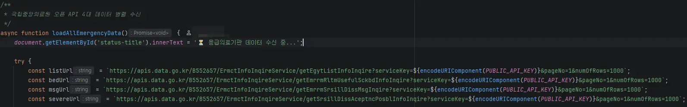
  &nbsp;
  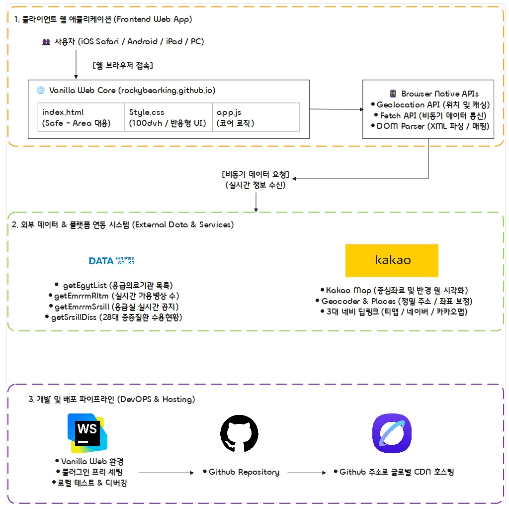
</p>

### 2. PC 웹 뷰 vs 모바일 반응형 뷰
<p align="center">
  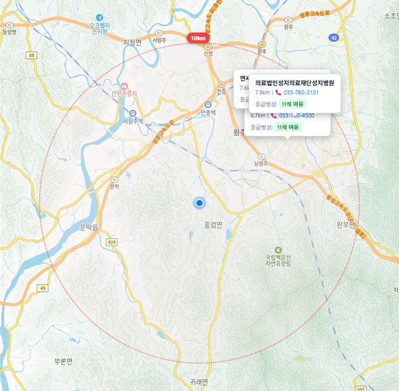
  &nbsp;
  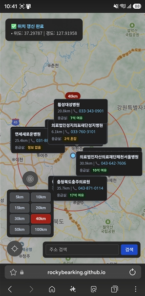
</p>

### 3. 병원 종별 필터링 및 거리 반경 오버레이
<p align="center">
  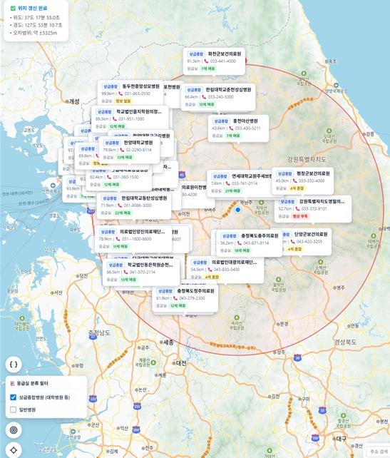
  &nbsp;
  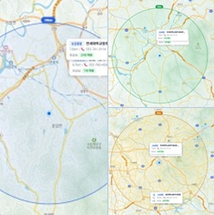
</p>

### 4. 법적 면책 조항 및 이용 안내 팝업
<p align="center">
  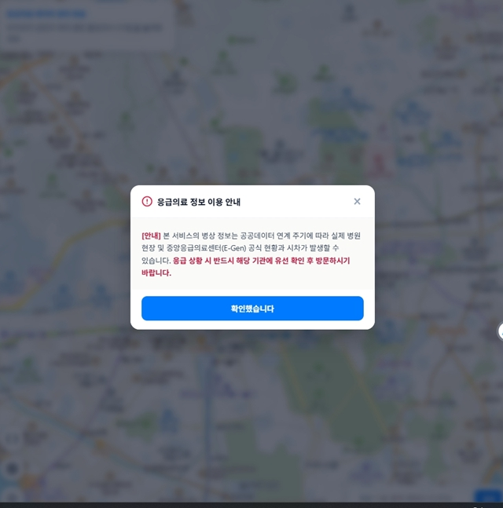
  &nbsp;
  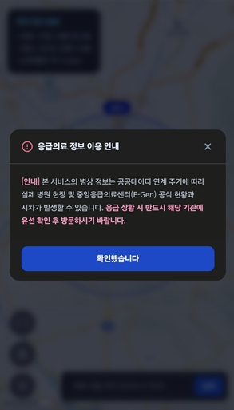
</p>

### 5. 권역외상센터 및 초기 프로토타입 비교
<p align="center">
  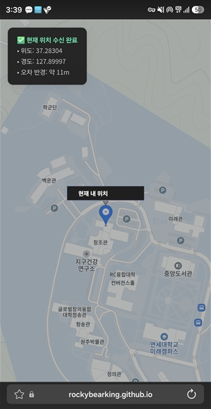
  &nbsp;&nbsp;&nbsp;&nbsp;
  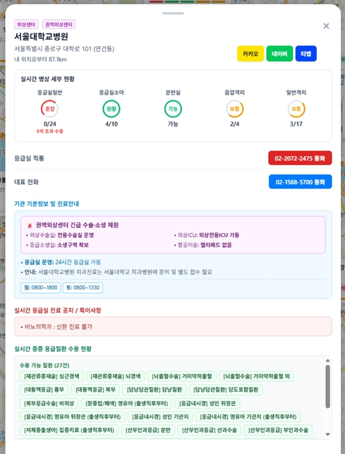
</p>

---

## 💻 실행 및 로컬 테스트 방법

별도의 빌드 도구나 Node.js 패키지 설치 없이 브라우저 환경에서 즉시 실행 가능한 순수 웹 표준(Vanilla Web) 프로젝트입니다.

### 방법 1: VS Code / WebStorm Live Server
1. WebStorm 또는 VS Code에서 본 프로젝트 폴더를 엽니다.
2. `index.html`을 우클릭한 후 **'Open with Live Server'**를 선택하여 실행합니다.

### 방법 2: Python 내장 로컬 웹 서버
```bash
# 프로젝트 루트 폴더에서 터미널 실행
python -m http.server 8000

# 브라우저에서 접속
http://localhost:8000
```

> **주의 사항**:  
> 카카오 지도 SDK는 로컬 서버(`http://localhost` 또는 `http://127.0.0.1`) 환경에서 정상 구동되도록 도메인 등록이 완료되어 있습니다. 반드시 로컬 웹 서버를 통해 실행해 주시기 바랍니다.